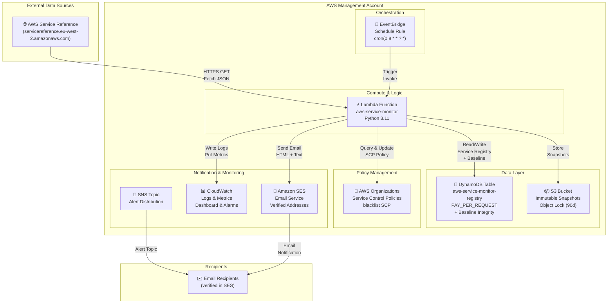
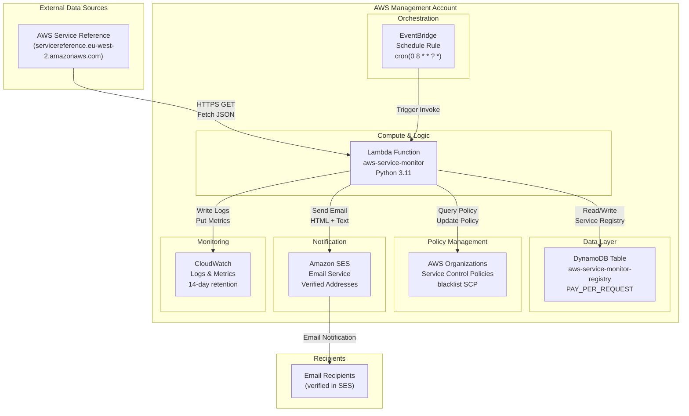
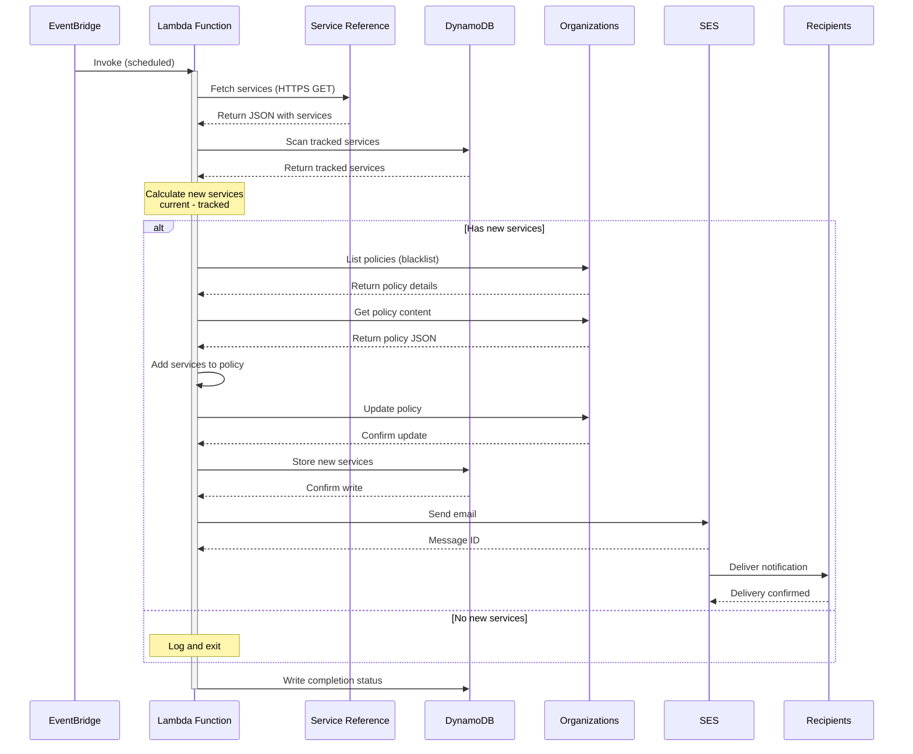
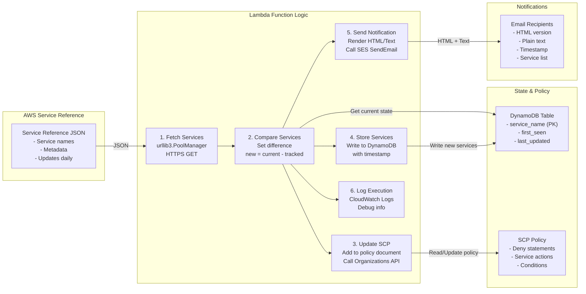
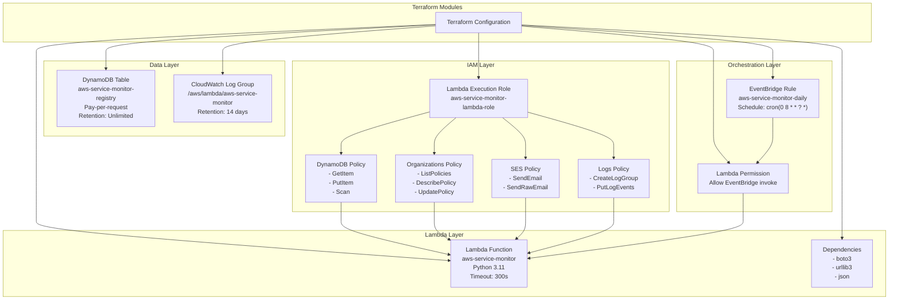
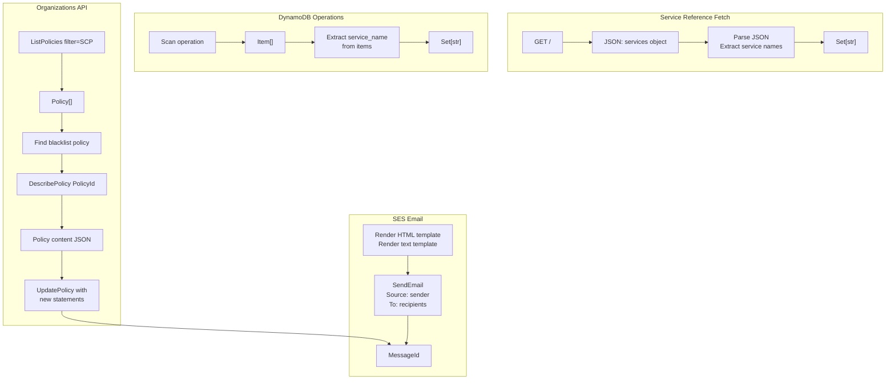
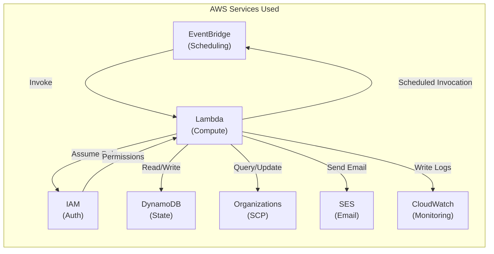
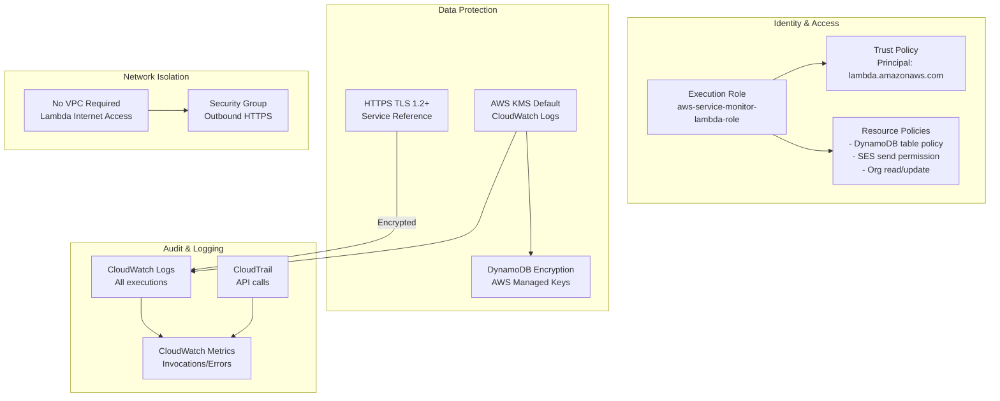
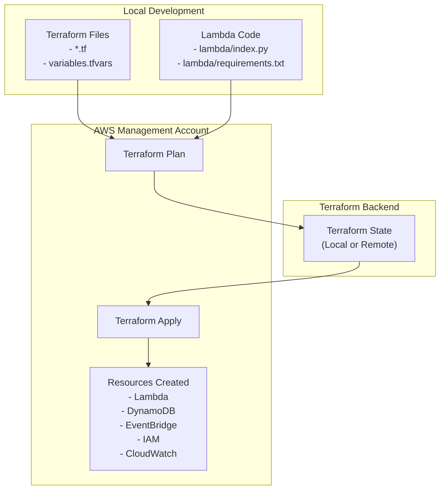

# 🏗️ Architecture Overview

Comprehensive architecture documentation for the AWS Service Monitor system, including detailed diagrams and explanations.

---

## 📑 Contents

1. [System Architecture](#system-architecture) - High-level system design
2. [Data Flow Diagram](#data-flow-diagram) - Request/response sequences
3. [Component Interactions](#component-interactions) - Service interactions
4. [Infrastructure Stack](#infrastructure-stack) - Terraform resources
5. [Request/Response Flow](#requestresponse-flow) - API-level details
6. [AWS Services](#aws-services-interaction) - Service dependencies
7. [Security Architecture](#security-architecture) - Security controls
8. [Deployment](#deployment-architecture) - Deployment process
9. [Scaling](#scaling-characteristics) - Performance & scaling
10. [Costs](#cost-architecture) - Cost breakdown
11. [Disaster Recovery](#disaster-recovery) - Backup & recovery

---

## System Architecture

**Overview**: Complete system architecture showing all AWS services and their relationships.





**Key Components**:
- **EventBridge**: Triggers Lambda on daily schedule (8 AM UTC)
- **Lambda**: Orchestrates all operations (10-20s typical execution)
- **DynamoDB**: Maintains service registry with baseline integrity checksums
- **S3**: Stores immutable snapshots with Object Lock for forensics
- **Organizations**: Manages SCP policy with new service additions
- **SES/SNS**: Sends email notifications and alerts
- **CloudWatch**: Logs all executions and publishes custom metrics

---

## Data Flow Diagram

**Execution Timeline**: Complete sequence of operations from trigger to completion.



**Flow Details**:
1. EventBridge triggers Lambda function (scheduled)
2. Lambda fetches current services from AWS service reference (HTTPS GET)
3. Lambda scans DynamoDB for previously tracked services
4. Compares current vs. tracked to identify new services
5. **If new services**: Updates SCP policy, stores new entries, sends email notification
6. **If no changes**: Logs result and exits
7. Publishes execution metrics to CloudWatch

---

## Component Interactions

**Step-by-Step Logic**: Detailed view of Lambda function operations and their sequence.



**Six-Step Process**:
1. **Fetch**: Get current services from AWS
2. **Compare**: Identify new services (set difference)
3. **Update SCP**: Add new services to blacklist policy
4. **Store**: Write new services to DynamoDB with timestamps
5. **Notify**: Send HTML + Text email to recipients
6. **Log**: Write execution details to CloudWatch

---

## Infrastructure Stack

**IaC Resources**: All AWS resources managed by Terraform.



**Hierarchy**:
- **IAM Layer**: Execution role with minimal required permissions
- **Lambda Layer**: Function configuration, timeout, memory, runtime
- **Data Layer**: DynamoDB table and CloudWatch log group
- **Orchestration**: EventBridge rule and Lambda invocation permission

All managed declaratively via Terraform for reproducibility.

---

## Request/Response Flow

**Detailed API Interactions**: Low-level view of all API calls made during execution.



**API Calls**:
- **Service Reference**: GET / → JSON response with services
- **DynamoDB**: Scan → Item[] → Extract service names
- **Organizations**: ListPolicies → Find blacklist → DescribePolicy → UpdatePolicy
- **SES**: SendEmail → MessageId response
- **CloudWatch**: PutMetricData → Success response

---

## AWS Services Interaction

**Service Dependencies**: Which AWS services are used and why.



## Security Architecture



## Deployment Architecture



## Scaling Characteristics

### Horizontal Scaling
- **EventBridge**: Unlimited invocations (AWS managed)
- **Lambda**: Auto-scales (concurrent execution limit: 1000 by default)
- **DynamoDB**: On-demand (auto-scales with pay-per-request)

### Vertical Scaling
- **Lambda Memory**: 128 MB - 10,240 MB (adjust in main.tf)
- **Lambda Timeout**: 300 seconds (configurable)
- **DynamoDB**: Unlimited storage (pay-per-request)

### Performance Characteristics

```
Service Fetch:     ~2-5 seconds
DynamoDB Scan:     ~1-2 seconds (depends on table size)
Service Comparison: <100 ms
SCP Update:        ~3-5 seconds
Email Send:        ~2-3 seconds
Total Execution:   ~10-20 seconds (typically)
```

## Cost Architecture

```
Component               | Cost Factor        | Estimated Monthly
------------------------|--------------------|-----------------
Lambda Execution        | 30 invocations     | $0.20
DynamoDB (on-demand)    | Scan + writes      | $1.00
CloudWatch Logs         | Log storage        | $0.50
SES Email              | Recipients count   | $0.10
EventBridge Rule       | 30 invocations     | Free
CloudWatch Metrics     | API calls          | Free
IAM Roles              | No cost            | Free
Organizations API      | API calls          | Free
```

## High Availability Considerations

### Current Architecture
- **Single Region**: Management account (eu-west-2)
- **Single Schedule**: Daily at 8 AM UTC
- **No Backup Lambda**: Single function invocation

### High Availability Options
1. **Multi-region Replication**: Deploy to multiple regions with cross-region state sync
2. **Backup Invocation**: Add secondary EventBridge rule as backup
3. **Lambda Concurrency**: Set reserved concurrency > 1
4. **DynamoDB Backup**: Enable point-in-time recovery
5. **Dead Letter Queue**: Send failed invocations to SQS

## Disaster Recovery

### Recovery Objectives
- **RTO** (Recovery Time Objective): < 1 hour (manual redeployment)
- **RPO** (Recovery Point Objective): 1 day (daily monitoring schedule)

### Backup Strategy
```
Service Registry State:
  - DynamoDB on-demand billing (pay for what you use)
  - Enable point-in-time recovery (optional)
  - Export to S3 daily (optional)

Lambda Code:
  - Stored in Git repository
  - Terraform manages versioning
  - Easy redeployment

SCP Policy:
  - Managed by Organizations API
  - Tracked in Terraform state
  - Version history in CloudTrail
```

## Related Documentation

- See [README.md](./README.md) for project overview
- See [DEPLOYMENT_GUIDE.md](./DEPLOYMENT_GUIDE.md) for setup instructions
- See [DEVELOPMENT.md](./DEVELOPMENT.md) for customization guidance
