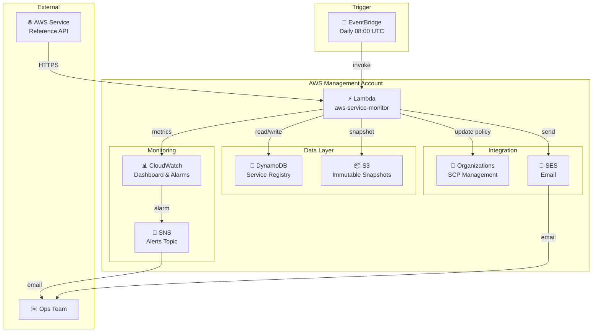

<div align="center">

# 🔍 AWS New Services Monitor

### Automatically detect new AWS services · update SCP deny-lists · alert your ops team

<br/>

[](https://aws.amazon.com)
[](https://www.python.org/)
[](cloudformation/)
[](terraform/)

<br/>

[](https://github.com/Sidford/aws-new-services)
[](SECURITY.md)
[](WELL_ARCHITECTED_REVIEW.md)
[](runbooks/)
[](README.md#-costs)

<br/>

[**Quick Start**](#-quick-start) · [**Architecture**](#-architecture) · [**Monitoring**](#-monitoring) · [**Security**](#-security) · [**Docs**](#-documentation)

</div>

---

## What it does

Every day at 08:00 UTC a Lambda function fetches the [AWS service reference](https://servicereference.us-east-1.amazonaws.com/), compares it against a DynamoDB registry, and acts on anything new:

```
AWS Service Reference  ──▶  Lambda  ──▶  DynamoDB (registry update)
                                    ──▶  Organizations (SCP deny-list)
                                    ──▶  SES (email notification)
                                    ──▶  CloudWatch (metrics & alarms)
                                    ──▶  S3 (immutable baseline snapshot)
```

New services are **blocked at the org level** the moment they appear — no manual triage needed. An approval workflow lets your team whitelist services they've assessed.

---

## ✨ Features

| | Feature | Detail |
|---|---------|--------|
| 🔄 | **Daily scanning** | EventBridge cron triggers Lambda at 08:00 UTC |
| 🎯 | **New-service detection** | Compares live reference against DynamoDB baseline |
| 📋 | **SCP management** | Adds `<service>:*` deny actions to your blacklist SCP |
| ✅ | **Approval workflow** | Move services from deny-list to approved list via parameter |
| 🌍 | **Regional intelligence** | Tracks when new services land in your region |
| 📧 | **Rich email alerts** | HTML + text notifications with per-service detail |
| 🛡️ | **Baseline integrity** | SHA-256 checksums + S3 Object Lock tamper detection |
| 📊 | **CloudWatch dashboard** | Lambda, DynamoDB, integrity status at a glance |
| 🚨 | **10 alarms** | Errors, timeouts, throttles, missed runs, integrity |
| 📖 | **Runbooks** | 9 operational procedures for on-call teams |
| 🏗️ | **Two IaC options** | CloudFormation (no tooling) or Terraform/OpenTofu |

---

## ⚡ Quick Start

> Choose **Option A** (CloudFormation — no extra tools needed) or **Option B** (Terraform).

### Prerequisites

```bash
aws --version                           # AWS CLI v2 required
aws ses list-verified-email-addresses   # confirm your sender/recipient emails are verified
```

| Requirement | Why |
|-------------|-----|
| AWS Organizations (management account) | SCP management |
| SES verified sender + recipient emails | Notifications |
| Existing SCP named `blacklist` | Policy to update |

---

### Option A — CloudFormation ✅ recommended

Two stacks keep the durable foundation (IAM, KMS, storage) separate from the compute layer (Lambda, alarms). **You only redeploy the application stack when the Lambda code changes.**

<details>
<summary><strong>Stack contents at a glance</strong></summary>

| Stack | Resources | When to deploy |
|-------|-----------|----------------|
| `aws-service-monitor-infra` | IAM role + boundary · KMS key · 3 DynamoDB tables · S3 bucket · SNS topic · Log group · 8 IAM policies | Once (or when IAM/storage config changes) |
| `aws-service-monitor-app` | Lambda function · EventBridge schedule · 10 CloudWatch alarms · Dashboard | On each Lambda code or alarm change |

</details>

#### 1️⃣ Configure

```bash
cp cloudformation/infra-parameters.example.json  cloudformation/infra-parameters.json
cp cloudformation/app-parameters.example.json    cloudformation/app-parameters.json
```

Edit `infra-parameters.json` — minimum required:

| Parameter | Example | Notes |
|-----------|---------|-------|
| `EmailRecipients` | `["ops@example.com"]` | Must be SES-verified |
| `SenderEmail` | `notifications@example.com` | Must be SES-verified |
| `OrganizationId` | `o-xxxxxxxxxxxx` | Scopes IAM to your org |

Edit `app-parameters.json` — key settings:

| Parameter | Default | Notes |
|-----------|---------|-------|
| `InfrastructureStackName` | `aws-service-monitor-infra` | Must match infra stack name |
| `ManageScpPolicy` | `true` | Set `false` for notify-only mode |
| `RequireScpApproval` | `true` | `false` = auto-apply SCP changes |

#### 2️⃣ Deploy — infrastructure stack

```bash
aws cloudformation deploy \
  --template-file cloudformation/infrastructure.yaml \
  --stack-name aws-service-monitor-infra \
  --parameter-overrides file://cloudformation/infra-parameters.json \
  --capabilities CAPABILITY_NAMED_IAM \
  --region eu-west-2
```

#### 3️⃣ Deploy — application stack

```bash
aws cloudformation deploy \
  --template-file cloudformation/application.yaml \
  --stack-name aws-service-monitor-app \
  --parameter-overrides file://cloudformation/app-parameters.json \
  --capabilities CAPABILITY_NAMED_IAM \
  --region eu-west-2
```

#### 4️⃣ Verify

```bash
# Both stacks should show CREATE_COMPLETE or UPDATE_COMPLETE
aws cloudformation describe-stacks \
  --stack-name aws-service-monitor-infra \
  --region eu-west-2 \
  --query 'Stacks[0].StackStatus'

aws cloudformation describe-stacks \
  --stack-name aws-service-monitor-app \
  --region eu-west-2 \
  --query 'Stacks[0].StackStatus'

# Trigger a manual test run
aws lambda invoke --function-name aws-service-monitor \
  --region eu-west-2 response.json && cat response.json | jq '.'
```

---

### Option B — Terraform / OpenTofu

#### 1️⃣ Configure

```bash
cp terraform/terraform.tfvars.example terraform/terraform.tfvars
vim terraform/terraform.tfvars
```

```hcl
aws_region       = "eu-west-2"
scp_name         = "blacklist"
email_recipients = ["ops-team@example.com"]
sender_email     = "aws-monitor@example.com"
```

#### 2️⃣ Deploy

```bash
cd terraform
terraform init
terraform plan
terraform apply
```

#### 3️⃣ Verify

```bash
aws lambda invoke --function-name aws-service-monitor /dev/stdout | jq '.'
```

---

## 🏗️ Architecture

### How it works

```
1. EventBridge fires daily at 08:00 UTC
   │
2. Lambda fetches https://servicereference.us-east-1.amazonaws.com/
   │
3. Verify baseline integrity (SHA-256 checksum vs DynamoDB)
   │  └─ FAIL → alert email + SNS + CloudWatch metric → stop
   │
4. Compare live services against DynamoDB registry
   │  └─ No new services → publish metrics → done
   │
5. New services found:
   ├─ Validate names (format + boto3 catalog check)
   ├─ Write to DynamoDB + update checksum
   ├─ Check regional availability (eu-west-2)
   ├─ Filter against approved-services list
   ├─ Update SCP deny-list (if ManageScpPolicy=true)
   └─ Send HTML + text email notification
```

### System diagram



### Resource inventory

| Layer | Resource | Purpose |
|-------|----------|---------|
| **Compute** | Lambda (Python 3.11, 300s) | Orchestration |
| **Schedule** | EventBridge rule | Daily trigger |
| **Registry** | DynamoDB `service-registry` | Known services + baseline |
| **Workflow** | DynamoDB `approved-services` | Approval state |
| **Regional** | DynamoDB `pending-regional` | Regional rollout tracking |
| **Integrity** | S3 bucket (Object Lock GOVERNANCE) | Immutable snapshots |
| **Alerts** | SNS topic | Alarm fan-out |
| **IAM** | Role + permission boundary + 8 policies | Least-privilege |
| **Encryption** | KMS CMK (auto-rotate) | DynamoDB at-rest |

---

## 📊 Monitoring

### Dashboard

[](https://console.aws.amazon.com/cloudwatch/home?region=eu-west-2#dashboards:name=aws-service-monitor)

Panels: Lambda invocations · errors · duration · new services detected · baseline integrity status.

### Alarms

| Alarm | Severity | Threshold | Runbook |
|-------|----------|-----------|---------|
| Lambda Errors | 🔴 CRITICAL | ≥ 1 / hour | Check CloudWatch Logs |
| Lambda Timeout | 🔴 CRITICAL | Duration ≥ 300 s | [Timeout runbook](runbooks/LAMBDA_TIMEOUT_RECOVERY.md) |
| Missed Execution | 🟠 WARNING | 0 invocations / 24 h | Check EventBridge rule |
| Baseline Integrity | 🔴 CRITICAL | Status = 0 | [Integrity runbook](runbooks/BASELINE_INTEGRITY_VIOLATION.md) |
| DynamoDB Throttles | 🟡 LOW | ≥ 1 | Monitor (on-demand auto-scales) |
| Unusual DDB Writes | 🔴 CRITICAL | > 500 WCU / h | Check CloudTrail |
| EventBridge Disabled | 🟠 WARNING | 0 rules fired / 24 h | Re-enable rule |
| Permission Boundary Deny | 🔴 CRITICAL | ≥ 1 hit | Investigate immediately |

[](https://console.aws.amazon.com/cloudwatch/home?region=eu-west-2#alarmsV2:alarmFilter=service-monitor)

---

## ⚙️ Configuration

### Schedule expressions

```
cron(0 8 * * ? *)    Daily at 08:00 UTC  (default)
cron(0 3 * * ? *)    Daily at 03:00 UTC
rate(12 hours)       Every 12 hours
rate(1 hour)         Every hour
```

### SCP approval modes

| `RequireScpApproval` | Behaviour |
|----------------------|-----------|
| `true` (default) | Lambda previews changes and notifies — **does not apply** |
| `false` | Lambda applies SCP changes automatically |

### Notifications-only mode

Set `ManageScpPolicy = false` to detect and alert without ever touching your SCP. Email templates automatically omit SCP-related sections in this mode.

---

## 🔐 Security

[](threat-model/THREAT_MODEL.md)
[](SECURITY.md)
[](SECURITY.md)

| Control | Implementation |
|---------|----------------|
| **Least privilege** | Permission boundary caps the Lambda role to exactly what it needs; `iam:*` is explicitly denied |
| **Encryption at rest** | DynamoDB uses a KMS CMK with automatic yearly rotation |
| **Tamper detection** | SHA-256 baseline checksum verified on every run; mismatch triggers CRITICAL alert |
| **Immutable audit trail** | S3 Object Lock (GOVERNANCE, 90-day retention) prevents snapshot deletion |
| **Input validation** | Service names validated against format rules + boto3 service catalog before SCP update |
| **No secrets** | IAM roles only — no hardcoded credentials anywhere |
| **TLS everywhere** | `ssl.create_default_context()` enforces certificate validation on all outbound calls |

**→** Full details: [SECURITY.md](SECURITY.md) · [Threat Model](threat-model/THREAT_MODEL.md)

---

## 💰 Costs

Estimated for daily execution in a single region:

| Service | Monthly usage | Est. cost |
|---------|--------------|-----------|
| Lambda | 30 invocations × 300 s | $0.20 |
| DynamoDB | On-demand (minimal WCU/RCU) | $1.00 |
| CloudWatch | Logs + 10 alarms + dashboard | $1.20 |
| SES | ~30 emails | $0.10 |
| S3 | Baseline snapshots | $0.02 |
| KMS | 1 CMK + API calls | $1.00 |
| **Total** | | **~$3.50 / month** |

> Actual costs vary by region and existing free-tier usage.

---

## 🔍 Operations

### Trigger a manual run

```bash
aws lambda invoke \
  --function-name aws-service-monitor \
  --region eu-west-2 \
  response.json && cat response.json | jq '.'
```

### Tail logs

```bash
# Live stream
aws logs tail /aws/lambda/aws-service-monitor --region eu-west-2 --follow

# Errors only
aws logs tail /aws/lambda/aws-service-monitor --region eu-west-2 \
  --filter-pattern "ERROR"
```

### Inspect the registry

```bash
# Service count
aws dynamodb scan \
  --table-name aws-service-monitor-registry \
  --select COUNT \
  --region eu-west-2

# Baseline record
aws dynamodb get-item \
  --table-name aws-service-monitor-registry \
  --region eu-west-2 \
  --key '{"service_name":{"S":"__baseline_initialized__"}}'
```

### Troubleshooting

| Symptom | First check | Command |
|---------|------------|---------|
| SCP not found | Policy name mismatch | `aws organizations list-policies --filter SERVICE_CONTROL_POLICY` |
| Email not delivered | SES sandbox / unverified address | `aws ses list-verified-email-addresses` |
| Lambda timeout | Memory too low | Increase `Timeout` / memory in template |
| Integrity violation | Unexpected DDB write | Review CloudTrail for `dynamodb:PutItem` calls |

---

## 🔄 Updates

### CloudFormation — add a new email recipient

```bash
# Edit cloudformation/infra-parameters.json, then:
aws cloudformation deploy \
  --template-file cloudformation/infrastructure.yaml \
  --stack-name aws-service-monitor-infra \
  --parameter-overrides file://cloudformation/infra-parameters.json \
  --capabilities CAPABILITY_NAMED_IAM \
  --region eu-west-2
```

### CloudFormation — update Lambda code or alarms

```bash
# Edit cloudformation/application.yaml, then:
aws cloudformation deploy \
  --template-file cloudformation/application.yaml \
  --stack-name aws-service-monitor-app \
  --parameter-overrides file://cloudformation/app-parameters.json \
  --capabilities CAPABILITY_NAMED_IAM \
  --region eu-west-2
```

### Terraform — any change

```bash
# Edit lambda/index.py or terraform/*.tf, then:
cd terraform && terraform apply
```

---

## 🧹 Cleanup

### CloudFormation

```bash
aws cloudformation delete-stack --stack-name aws-service-monitor-app  --region eu-west-2
aws cloudformation delete-stack --stack-name aws-service-monitor-infra --region eu-west-2
```

> ⚠️ The S3 bucket has Object Lock enabled. Terraform/CFn cannot delete it while objects are retained. See [DEPLOYMENT_GUIDE.md](DEPLOYMENT_GUIDE.md) for the manual cleanup steps.

### Terraform

```bash
cd terraform && terraform destroy
```

---

## 📖 Documentation

| Doc | What's in it | Audience |
|-----|-------------|----------|
| [ARCHITECTURE.md](ARCHITECTURE.md) | Full data-flow diagrams, component interactions | Architects |
| [DEPLOYMENT_GUIDE.md](DEPLOYMENT_GUIDE.md) | Step-by-step bootstrap + deploy | DevOps |
| [BASELINE_INITIALIZATION.md](BASELINE_INITIALIZATION.md) | First-run behaviour explained | DevOps |
| [SECURITY.md](SECURITY.md) | Security controls, threat mitigations | Security |
| [threat-model/THREAT_MODEL.md](threat-model/THREAT_MODEL.md) | STRIDE threat model | Security eng |
| [WELL_ARCHITECTED_REVIEW.md](WELL_ARCHITECTED_REVIEW.md) | AWS Well-Architected (8/10) | Architects |
| [runbooks/OPERATIONAL_GUIDE.md](runbooks/OPERATIONAL_GUIDE.md) | Day-2 operations | On-call |
| [runbooks/INCIDENT_RESPONSE.md](runbooks/INCIDENT_RESPONSE.md) | Incident playbooks | On-call |
| [TESTING_GUIDE.md](TESTING_GUIDE.md) | Manual test procedures | DevOps |

---

<div align="center">

Built with ❤️ for AWS security teams

[](ARCHITECTURE.md)
[](SECURITY.md)
[](runbooks/)

</div>
