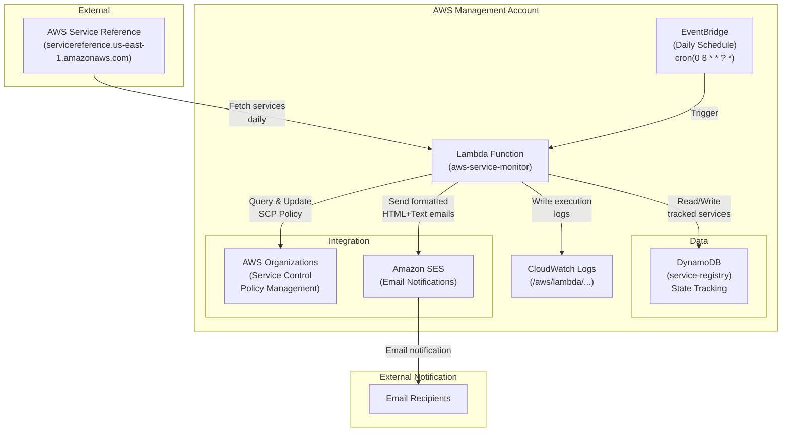

# AWS New Services Monitor with SCP Management

A Terraform/OpenTofu project that automatically monitors AWS for new services and manages a Service Control Policy (SCP) blacklist in your AWS Organization's management account.

## Features

- **Automated Monitoring**: Fetches the AWS service reference daily
- **New Service Detection**: Identifies only new services (ignores API changes)
- **State Tracking**: Maintains a registry of known services in DynamoDB
- **SCP Management**: Automatically updates the blacklist SCP with new services
- **Email Notifications**: Sends human-readable emails when new services are detected
- **Fully Infrastructure-as-Code**: Terraform/OpenTofu based deployment

## Architecture



For detailed architecture documentation, see [ARCHITECTURE.md](./ARCHITECTURE.md)

## Prerequisites

- AWS Organizations enabled with management account access
- AWS credentials configured for the management account
- Terraform or OpenTofu installed (v1.0+)
- Email addresses verified in AWS SES (Simple Email Service) for your region
- An existing Service Control Policy named "blacklist" (or customize via `scp_name` variable)

### Email Setup in SES

Before deploying, verify your email addresses in AWS SES:

```bash
# Using AWS CLI
aws ses verify-email-identity --email-address ops-team@example.com --region us-east-1
aws ses verify-email-identity --email-address aws-monitor@example.com --region us-east-1
```

Check your email for verification links and click them.

## Deployment

### 1. Configure Variables

Create a `terraform.tfvars` file from the example:

```bash
cp terraform.tfvars.example terraform.tfvars
```

Edit `terraform.tfvars` with your specific values:

```hcl
aws_region = "us-east-1"
schedule_expression = "cron(0 8 * * ? *)"  # 8 AM UTC daily
scp_name = "blacklist"
email_recipients = ["ops-team@example.com"]
sender_email = "aws-monitor@example.com"
```

### 2. Initialize and Plan

```bash
terraform init
terraform plan
```

### 3. Apply the Configuration

```bash
terraform apply
```

This will create:
- DynamoDB table for service registry
- Lambda function with necessary IAM roles
- EventBridge rule for daily scheduling
- CloudWatch log group for monitoring

## Usage

### Manual Trigger

To manually test the Lambda function:

```bash
aws lambda invoke \
  --function-name aws-service-monitor \
  --region us-east-1 \
  response.json

cat response.json
```

### View Logs

Monitor the Lambda execution logs:

```bash
aws logs tail /aws/lambda/aws-service-monitor --follow --region us-east-1
```

### Check Service Registry

View services stored in DynamoDB:

```bash
aws dynamodb scan \
  --table-name aws-service-monitor-registry \
  --region us-east-1
```

## Email Notification Format

When new services are detected, you'll receive formatted emails with:

- **Subject**: "AWS Service Monitor: N New Service(s) Detected"
- **Body** (HTML): Nicely formatted with:
  - List of new services detected
  - Timestamp of the scan
  - Actions taken (SCP update, registry update)
  - Next steps for review
- **Body** (Plain Text): Alternative text version for email clients that don't support HTML

Example services in email:
```
- apigateway
- autoscaling
- dynamodb
- lambda
- s3
```

## SCP Integration

The Lambda function will update your "blacklist" SCP by:

1. Fetching the current policy from Organizations
2. Adding new services to the deny list
3. Updating the policy with the new service restrictions

**Note**: The SCP must exist before deployment. Create it if needed:

```bash
aws organizations create-policy \
  --content file://blacklist-policy.json \
  --description "Blacklist policy for restricted services" \
  --name blacklist \
  --type SERVICE_CONTROL_POLICY
```

Example `blacklist-policy.json`:

```json
{
  "Version": "2012-10-17",
  "Statement": [
    {
      "Effect": "Deny",
      "Action": "*",
      "Resource": "*",
      "Condition": {
        "StringEquals": {
          "aws:PrincipalOrgID": "*"
        }
      }
    }
  ]
}
```

## Scheduling

The default schedule runs daily at 8 AM UTC. Modify the `schedule_expression` variable to change:

| Expression | Meaning |
|-----------|---------|
| `cron(0 8 * * ? *)` | Daily at 8 AM UTC |
| `cron(0 3 * * ? *)` | Daily at 3 AM UTC |
| `rate(12 hours)` | Every 12 hours |
| `rate(1 hour)` | Every hour |

[More cron expression examples](https://docs.aws.amazon.com/eventbridge/latest/userguide/eb-cron-expressions.html)

## Monitoring

### CloudWatch Metrics

The Lambda function logs execution details. Monitor key metrics:

- Execution count
- Error rate
- Duration
- New services detected

### CloudWatch Alarms (Optional)

Create an alarm for Lambda errors:

```bash
aws cloudwatch put-metric-alarm \
  --alarm-name aws-service-monitor-errors \
  --alarm-description "Alert on Lambda errors" \
  --metric-name Errors \
  --namespace AWS/Lambda \
  --statistic Sum \
  --period 3600 \
  --threshold 1 \
  --comparison-operator GreaterThanOrEqualToThreshold \
  --dimensions Name=FunctionName,Value=aws-service-monitor
```

## Costs

Estimated monthly costs (for 1 service monitor in us-east-1):

- **Lambda**: ~$0.20 (30 invocations × 300 seconds @ 1024 MB)
- **DynamoDB**: ~$1.00 (on-demand pricing)
- **CloudWatch Logs**: ~$0.50 (log retention)
- **SES**: ~$0.10 (30 emails)

**Total**: ~$2 per month

## Troubleshooting

### Lambda Execution Errors

Check logs:
```bash
aws logs tail /aws/lambda/aws-service-monitor --follow
```

### SCP Not Updating

Verify the SCP exists:
```bash
aws organizations list-policies --filter SERVICE_CONTROL_POLICY
```

### Emails Not Sending

- Verify email addresses in SES:
  ```bash
  aws ses list-verified-email-addresses
  ```
- Check if account is in SES sandbox mode (verify all recipients)

### Services Not Being Tracked

Check DynamoDB table:
```bash
aws dynamodb scan --table-name aws-service-monitor-registry
```

## Updating the Deployment

### Add New Recipients

Update `terraform.tfvars`:
```hcl
email_recipients = ["ops-team@example.com", "new-recipient@example.com"]
```

Apply changes:
```bash
terraform apply
```

### Change Schedule

Update `schedule_expression` in `terraform.tfvars` and reapply.

### Modify Lambda Function

Edit `lambda/index.py`, then:
```bash
terraform apply
```

The Lambda code zip will be rebuilt automatically.

## Cleanup

To remove all resources:

```bash
terraform destroy
```

This will delete:
- Lambda function
- DynamoDB table (with all service history)
- IAM roles
- EventBridge rules
- CloudWatch log group

## Advanced Configuration

### Customize Email Template

Edit `generate_html_email()` and `generate_text_email()` functions in `lambda/index.py`.

### Filter Specific Services

Modify the service fetch logic in `fetch_aws_services()` to exclude certain services.

### Change SCP Strategy

Update `update_scp_with_services()` to implement different SCP modification logic.

## Security Best Practices

- **Least Privilege**: The Lambda role has minimal required permissions
- **No Hardcoded Credentials**: Uses IAM role assumed by Lambda
- **Encrypted Logs**: CloudWatch logs are encrypted by default
- **No Data Retention**: Service registry only stores service names
- **Email Security**: Verify all recipients in SES before sending

## Support & Issues

For issues or feature requests, check:
- CloudWatch logs: `/aws/lambda/aws-service-monitor`
- Lambda console for execution history
- DynamoDB table scan results