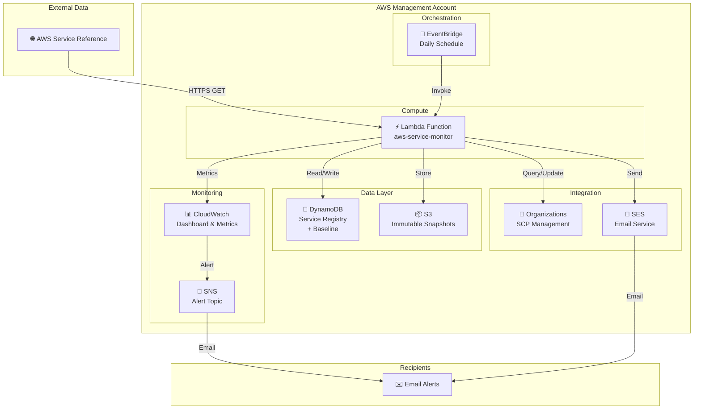

# 🔍 AWS New Services Monitor with SCP Management

<div align="center">

[](https://aws.amazon.com)
[](https://terraform.io)
[](cloudformation/)
[](https://www.python.org/)
[](#)

Automatically monitor AWS for new services and manage Service Control Policy blacklists 🚀

[Features](#-features) • [Quick Start](#-quick-start) • [Architecture](#-architecture) • [Monitoring](#-monitoring) • [Docs](#-documentation)

</div>

---

## 🎯 Features

| Feature | Description |
|---------|-------------|
| 🔄 **Automated Monitoring** | Daily Lambda invocation fetches AWS service reference |
| 🎯 **Smart Detection** | Identifies only new services (ignores API changes) |
| 💾 **State Tracking** | DynamoDB registry with baseline integrity verification |
| 📋 **SCP Management** | Auto-update blacklist SCP with new services (cautious-by-default) |
| 🌍 **Regional Intelligence** | Track when services become available in your region (eu-west-2) |
| 📧 **Email Alerts** | HTML + Text notifications with regional status info |
| 🛡️ **Data Protection** | SHA256 checksums + S3 Object Lock snapshots |
| 📊 **Real-time Dashboard** | CloudWatch dashboard with key metrics |
| 🚨 **Smart Alerting** | 8 CloudWatch alarms with SNS notifications |
| 📖 **Runbooks** | 9 comprehensive operational procedures |
| 🏗️ **Infrastructure as Code** | Full Terraform/OpenTofu deployment |

---

## ⚡ Quick Start

> **Two deployment options** — CloudFormation (no extra tooling) or Terraform/OpenTofu.

### Prerequisites

```bash
aws --version       # AWS CLI v2
aws ses list-verified-email-addresses
```

**Required**:
- ✅ AWS Organizations (management account)
- ✅ SES verified email addresses
- ✅ Existing SCP named "blacklist"

---

### Option A — CloudFormation (recommended)

The stack is split into two templates so the durable foundation (IAM, KMS, DynamoDB, S3, SNS) is deployed once and the compute layer (Lambda, alarms, dashboard) is updated independently whenever the code changes.

#### 1️⃣ Configure

```bash
cp cloudformation/infra-parameters.example.json  cloudformation/infra-parameters.json
cp cloudformation/app-parameters.example.json    cloudformation/app-parameters.json

# Edit both files with your email addresses, org ID, etc.
```

#### 2️⃣ Deploy — infrastructure stack (once)

```bash
aws cloudformation deploy \
  --template-file cloudformation/infrastructure.yaml \
  --stack-name aws-service-monitor-infra \
  --parameter-overrides file://cloudformation/infra-parameters.json \
  --capabilities CAPABILITY_NAMED_IAM \
  --region eu-west-2
```

**Creates**: IAM role + permission boundary, KMS key, 3 DynamoDB tables, S3 baseline bucket, SNS topic, CloudWatch log group, all IAM policies.

#### 3️⃣ Deploy — application stack

```bash
aws cloudformation deploy \
  --template-file cloudformation/application.yaml \
  --stack-name aws-service-monitor-app \
  --parameter-overrides file://cloudformation/app-parameters.json \
  --capabilities CAPABILITY_NAMED_IAM \
  --region eu-west-2
```

**Creates**: Lambda function, EventBridge daily schedule, 10 CloudWatch alarms, CloudWatch dashboard.

> Re-run only this command whenever the Lambda code or alarm thresholds change.

#### 4️⃣ Verify

```bash
# Check stacks are complete
aws cloudformation describe-stacks \
  --stack-name aws-service-monitor-infra --region eu-west-2 \
  --query 'Stacks[0].StackStatus'

aws cloudformation describe-stacks \
  --stack-name aws-service-monitor-app --region eu-west-2 \
  --query 'Stacks[0].StackStatus'

# Test the Lambda manually
aws lambda invoke --function-name aws-service-monitor \
  --region eu-west-2 response.json && cat response.json
```

---

### Option B — Terraform / OpenTofu

#### 1️⃣ Configure

```bash
cp terraform/terraform.tfvars.example terraform/terraform.tfvars
vim terraform/terraform.tfvars
```

**Key Settings**:
```hcl
aws_region       = "eu-west-2"
scp_name         = "blacklist"
email_recipients = ["ops-team@example.com"]
sender_email     = "aws-monitor@example.com"
```

#### 2️⃣ Deploy

```bash
cd terraform

terraform init
terraform plan
terraform apply
```

#### 3️⃣ Verify

```bash
# Check Lambda deployed
aws lambda list-functions | grep aws-service-monitor

# Test manually
aws lambda invoke --function-name aws-service-monitor /dev/stdout | jq '.'
```

---

## 🏗️ Architecture

### System Overview



**For detailed architecture and data flow diagrams**: See [ARCHITECTURE.md](./ARCHITECTURE.md)

---

## 📊 Monitoring

### CloudWatch Dashboard

Access: [AWS Service Monitor Dashboard](https://console.aws.amazon.com/cloudwatch/home?region=eu-west-2#dashboards:name=aws-service-monitor)

**Displays**:
- Lambda invocations, errors, duration (avg & p99)
- DynamoDB consumed capacity & throttles
- New services detected (daily)
- Baseline integrity status
- CloudWatch Logs Insights for errors

### Alarms

| Alarm | Severity | Threshold | Action |
|-------|----------|-----------|--------|
| Lambda Errors | 🔴 CRITICAL | ≥1/hour | Check logs |
| Lambda Timeout | 🔴 CRITICAL | ≥300s | Increase memory |
| DynamoDB Throttles | 🟠 WARNING | ≥1 | Monitor (auto-scales) |
| Baseline Integrity | 🔴 CRITICAL | Failed | [Runbook](./runbooks/BASELINE_INTEGRITY_VIOLATION.md) |
| Missed Execution | 🟠 WARNING | 0/24h | Check EventBridge |

**→ View all alarms**: [CloudWatch Alarms](https://console.aws.amazon.com/cloudwatch/home?region=eu-west-2#alarmsV2:alarmFilter=service-monitor)

---

## 📖 Documentation

| Doc | Purpose | Audience |
|-----|---------|----------|
| 📘 [README.md](./README.md) | This file - Quick start | Everyone |
| 🏗️ [ARCHITECTURE.md](./ARCHITECTURE.md) | System design & data flows | Architects |
| 🔐 [SECURITY.md](./SECURITY.md) | Security controls | Security team |
| 🛡️ [threat-model/THREAT_MODEL.md](./threat-model/THREAT_MODEL.md) | Threats & mitigations | Security eng |
| 📋 [threat-model/T004_IMPLEMENTATION.md](./threat-model/T004_IMPLEMENTATION.md) | Data tampering protection | DevOps |
| 📊 [WELL_ARCHITECTED_REVIEW.md](./WELL_ARCHITECTED_REVIEW.md) | AWS framework (8/10) | Architects |
| 📖 [DEPLOYMENT_GUIDE.md](./DEPLOYMENT_GUIDE.md) | Step-by-step setup | DevOps |
| 🚀 [BASELINE_INITIALIZATION.md](./BASELINE_INITIALIZATION.md) | First-run setup | DevOps |
| 🔧 [runbooks/OPERATIONAL_GUIDE.md](./runbooks/OPERATIONAL_GUIDE.md) | Operational procedures | On-call |
| 🆘 [runbooks/INCIDENT_RESPONSE.md](./runbooks/INCIDENT_RESPONSE.md) | Incident response | On-call |

---

## 📋 Configuration

### Scheduling

```hcl
# Choose your schedule
schedule_expression = "cron(0 8 * * ? *)"    # Daily 8 AM UTC
schedule_expression = "cron(0 3 * * ? *)"    # Daily 3 AM UTC
schedule_expression = "rate(12 hours)"       # Every 12 hours
schedule_expression = "rate(1 hour)"         # Every hour
```

### Approval Workflow

```hcl
# Auto-update (default)
require_scp_approval = false

# Manual approval (preview only)
require_scp_approval = true
```

---

## 📧 Email Notifications

**When**: New services detected  
**Format**: HTML + Plain text

```
From: aws-monitor@example.com
Subject: AWS Service Monitor: 3 New Service(s) Detected

New services:
  • apigateway-v2
  • forecast
  • s3-express

Status: SCP updated
Time: 2026-04-24 08:15:33 UTC
```

---

## 💰 Costs

### Estimated Monthly

| Service | Usage | Cost |
|---------|-------|------|
| Lambda | 30 invocations | $0.20 |
| DynamoDB | On-demand | $1.00 |
| CloudWatch | Logs + Alarms | $1.20 |
| SES | ~30 emails | $0.10 |
| S3 | Snapshots | $0.02 |
| **Total** | | **~$2.50/month** |

---

## 🔍 Usage

### Manual Test

```bash
# Invoke Lambda
aws lambda invoke \
  --function-name aws-service-monitor \
  response.json && cat response.json | jq '.'
```

### View Logs

```bash
# Real-time tail
aws logs tail /aws/lambda/aws-service-monitor --follow

# Errors only
aws logs tail /aws/lambda/aws-service-monitor \
  --filter-pattern "ERROR"
```

### Check Registry

```bash
# Count services
aws dynamodb scan \
  --table-name aws-service-monitor-registry \
  --select COUNT

# View baseline
aws dynamodb get-item \
  --table-name aws-service-monitor-registry \
  --key '{"service_name":{"S":"__baseline_initialized__"}}'
```

---

## 🆘 Troubleshooting

### Lambda Errors

```bash
aws logs tail /aws/lambda/aws-service-monitor --filter-pattern "ERROR"
```

**Common fixes**:
- ❌ SCP not found? → `aws organizations list-policies --filter SERVICE_CONTROL_POLICY`
- ❌ Email failed? → `aws ses list-verified-email-addresses`
- ❌ Timeout? → Increase Lambda memory in `terraform.tfvars`

### DynamoDB

```bash
# Check table status
aws dynamodb describe-table --table-name aws-service-monitor-registry \
  --query 'Table.{Status, ItemCount}'
```

### SES

```bash
# List verified addresses
aws ses list-verified-email-addresses

# Check sandbox status
aws ses get-account-sending-enabled
```

---

## 🔄 Updates

### Add Recipients

```bash
# Edit terraform.tfvars
email_recipients = ["ops-team@example.com", "new-team@example.com"]

# Apply
terraform apply
```

### Change Schedule

```bash
# Edit terraform.tfvars
schedule_expression = "cron(0 2 * * ? *)"

# Apply
terraform apply
```

### Update Lambda Code

```bash
# Edit lambda/index.py
# Reapply (zip rebuilt automatically)
terraform apply
```

---

## 🧹 Cleanup

```bash
# Remove everything
terraform destroy

# This deletes:
# ❌ Lambda, DynamoDB, EventBridge, IAM, CloudWatch, S3
# ⚠️  DynamoDB deletion is permanent!
```

---

## 🔐 Security

| Control | Implementation |
|---------|----------------|
| **Least Privilege** | Minimal IAM permissions |
| **Encryption** | DynamoDB + logs encrypted |
| **No Secrets** | IAM roles (no hardcoded creds) |
| **HTTPS** | Service reference with cert validation |
| **Integrity** | SHA256 checksums + Object Lock |
| **Audit** | CloudTrail logs all API calls |

**→ See**: [SECURITY.md](./SECURITY.md)

---

## 📞 Support

### Quick Links

- 📊 [CloudWatch Dashboard](https://console.aws.amazon.com/cloudwatch/home?region=eu-west-2#dashboards:name=aws-service-monitor)
- 🚨 [Alarms](https://console.aws.amazon.com/cloudwatch/home?region=eu-west-2#alarmsV2:alarmFilter=service-monitor)
- 💾 [DynamoDB Table](https://console.aws.amazon.com/dynamodb/home?region=eu-west-2#/tables/aws-service-monitor-registry)
- 📦 [S3 Snapshots](https://s3.console.aws.amazon.com/s3/buckets?region=eu-west-2)

### Common Commands

```bash
# Overall status
terraform output

# Check all alarms
aws cloudwatch describe-alarms | grep service-monitor

# SNS topic
aws sns list-topics | grep service-monitor

# S3 snapshots
aws s3 ls s3://service-monitor-baseline-$(aws sts get-caller-identity --query Account --output text)-eu-west-2/
```

---

<div align="center">

**Built with ❤️ for AWS Security** | [Docs](./ARCHITECTURE.md) | [Issues](https://github.com/baldrickuk/aws-new-services/issues)

</div>
