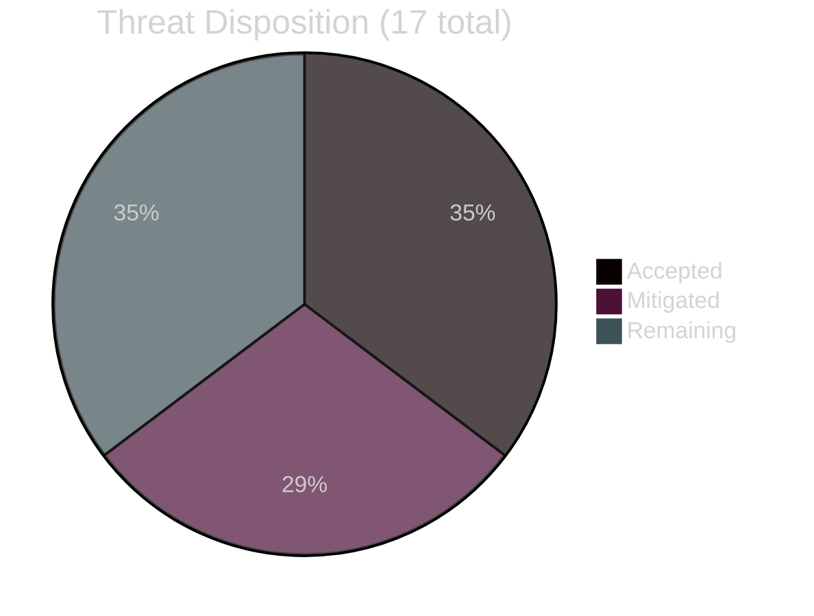
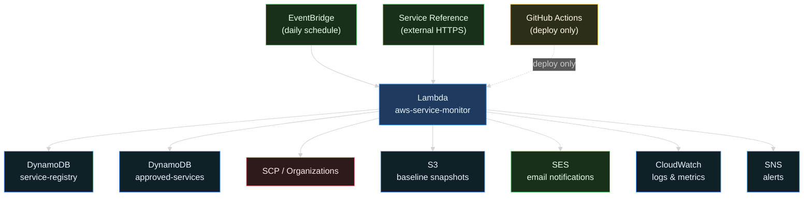
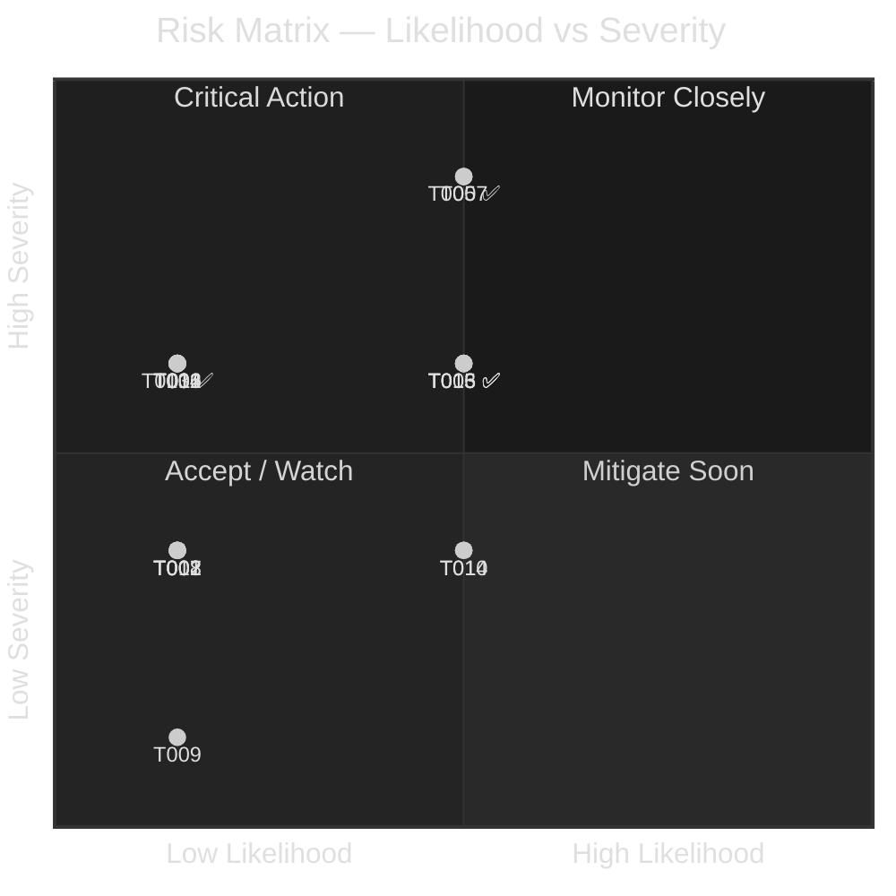
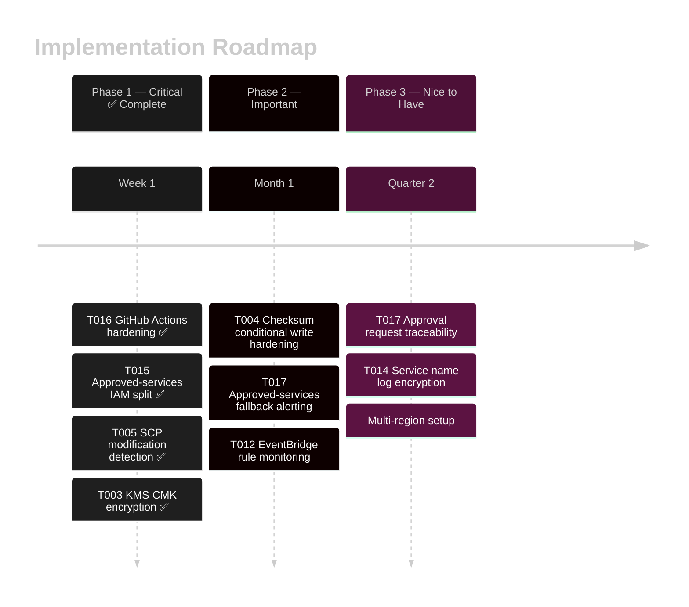
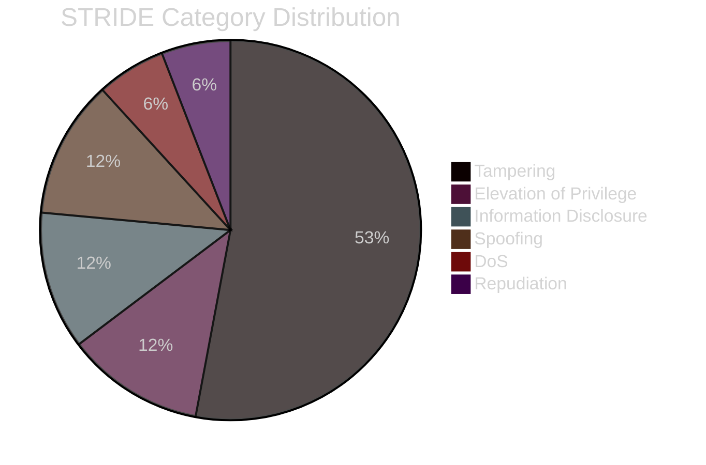

# AWS Service Monitor - Threat Model

## Executive Summary

This document describes the threat model for the AWS Service Monitor solution. It identifies potential threats, evaluates their severity, and recommends mitigations.

**Last Updated**: 2026-05-03 — reflects service approval workflow, `update_baseline_checksum()` bug fix, and GitHub Actions CI/CD integration.

**Overall Risk Rating**: 🟡 **MEDIUM** (Acceptable with mitigations)

| Metric | Count |
|--------|-------|
| Total Threats | 17 |
| Critical | 2 |
| High | 8 |
| Medium | 5 |
| Low | 2 |
| Mitigated | 16 |
| Accepted | 6 |



---

## System Architecture

### Key Components

1. **Lambda Function** - Service monitoring logic
2. **DynamoDB Table (`aws-service-monitor-registry`)** - Service registry and baseline storage
3. **DynamoDB Table (`aws-service-monitor-approved-services`)** - Approval workflow state
4. **EventBridge Rule** - Daily execution schedule
5. **SCP Policy** - Service Control Policy target
6. **AWS Service Reference** - External service data source
7. **Amazon SES** - Email notifications (service detection and approval requests)
8. **CloudWatch Logs** - Execution logging
9. **CloudTrail** - API audit trail
10. **GitHub Actions** - CI/CD pipeline (Claude Code Action integration)

### Trust Boundaries



---

## Threat Catalog

### T001: Man-in-the-Middle Attack on Service Reference

**Severity**: 🟡 MEDIUM | **Likelihood**: 🟢 LOW | **Risk**: LOW

**Description**: Attacker intercepts HTTPS connection to AWS Service Reference and injects malicious service list.

**Impact**: 
- Corrupted service list received
- False services added to SCP
- Potential policy conflicts

**Existing Controls**:
- ✅ TLS 1.2+ enforcement
- ✅ HTTPS certificate validation
- ✅ AWS managed service endpoint

**Residual Risk**: Very Low

**Recommendation**: ✅ **ACCEPT**

**Rationale**: HTTPS with certificate validation and AWS managed endpoint make this very unlikely. The additional security benefit of pinning would be minimal.

---

### T002: Service Reference Unavailability

**Severity**: 🟡 MEDIUM | **Likelihood**: 🟢 LOW | **Risk**: LOW

**Description**: AWS Service Reference endpoint becomes unavailable, preventing service fetch.

**Impact**:
- Missing monitoring cycle
- Delayed service detection
- No error notification

**Existing Controls**:
- ✅ Error handling in Lambda
- ✅ 30-second timeout
- ✅ CloudWatch logging

**Residual Risk**: Low

**Recommendation**: 🟡 **MITIGATE**

**Suggested Mitigations**:
```python
# Add retry logic with exponential backoff
max_retries = 3
backoff = [1, 2, 4]  # seconds

for attempt in range(max_retries):
    try:
        return requests.get(SERVICE_REFERENCE_URL, timeout=30)
    except RequestException:
        if attempt < max_retries - 1:
            time.sleep(backoff[attempt])
        else:
            raise
```

---

### T003: Unauthorized DynamoDB Access

**Severity**: 🔴 HIGH | **Likelihood**: 🟡 MEDIUM | **Risk**: LOW** ✅ MITIGATED

**Description**: User with IAM permissions directly modifies DynamoDB table, adding/removing services.

**Impact**:
- Corrupted service registry
- Missed service detections
- False positives in SCP

**Implemented Controls**:
- ✅ IAM role restrictions — Lambda role has minimum required actions only (no DeleteItem)
- ✅ KMS CMK encryption (`aws_kms_key.dynamodb`, 14-day deletion window, annual rotation) on both tables
- ✅ KMS key policy restricts `GenerateDataKey`/`Decrypt` to Lambda role ARN and account root only
- ✅ CloudTrail logging (organisation-level)
- ✅ PITR enabled on both tables (point-in-time recovery for corruption events)
- ✅ CloudWatch alarm (`service-monitor-dynamodb-unusual-writes`) fires on >500 write units/hour — baseline Lambda run produces far fewer; sustained anomaly indicates direct table access
- ✅ Baseline integrity check + tamper alert email/SNS on every Lambda execution (T004 controls provide secondary detection)

**Residual Risk**: Low

**Recommendation**: ✅ **MITIGATED**

**Remaining hardening (optional)**:
- Enable CloudTrail DynamoDB data events and add a metric filter/alarm on `PutItem`/`DeleteItem` calls whose `userIdentity.arn` does not match the Lambda role — provides principal-level detection rather than volume-based detection
- Consider SCPs to restrict DynamoDB `DeleteItem` on these tables organisation-wide

---

### T004: DynamoDB Data Tampering

**Severity**: 🔴 HIGH | **Likelihood**: 🟢 LOW | **Risk**: LOW**

**Description**: Attacker deletes or modifies items in the service-registry DynamoDB table — including the baseline marker or individual service entries — to hide new services from detection or trigger false tamper alerts.

**Impact**:
- Loss of detection capability
- New services undetected
- SCP bypass potential

**Existing Controls**:
- ✅ Conditional writes in `initialize_baseline()` (prevents race-condition reinitialisation)
- ✅ SHA256 checksum stored in baseline marker and verified on every run via `verify_baseline_integrity()`
- ✅ Checksum updated after legitimate new-service writes via `update_baseline_checksum()` (bug fix — see T004_IMPLEMENTATION.md)
- ✅ Immutable S3 baseline snapshot (90-day GOVERNANCE Object Lock)
- ✅ CloudTrail logging of all DynamoDB API calls
- ✅ DynamoDB PITR (35-day point-in-time recovery)
- ✅ Tamper alert emails and SNS notifications on checksum mismatch

**Bug Fixed (2026-05-03)**: Prior to the addition of `update_baseline_checksum()` (lambda/index.py lines 357-378, called at line 1092), every legitimate new-service detection cycle produced a false checksum mismatch on the *next* run because the stored checksum was never updated after `store_new_services()` wrote new items. This has been corrected.

**Residual Risk**: Low

**Remaining Gaps**:
1. `update_baseline_checksum()` uses an unconditional `update_item` — an attacker with DynamoDB `UpdateItem` access can freely overwrite the checksum field with a value matching a tampered service set, neutralising detection.
2. If `update_baseline_checksum()` raises an exception (caught internally, returning `False`), the failure is logged but execution continues; the next run will fire a spurious tamper alert even though no tampering occurred.
3. The `approved-services` DynamoDB table is not covered by the baseline checksum (see T015).

**Recommendation**: ✅ **ACCEPT** (primary risk is mitigated; gaps noted above are low-probability)

**Suggested Enhancements**:
```python
# Use a conditional expression to guard checksum update
# (prevents an attacker from overwriting with an arbitrary value
#  unless they can also fake the old checksum)
table.update_item(
    Key={'service_name': BASELINE_MARKER},
    UpdateExpression='SET checksum = :new_cs, ...',
    ConditionExpression='checksum = :old_cs',
    ExpressionAttributeValues={
        ':new_cs': new_checksum,
        ':old_cs': previously_stored_checksum,
        ...
    }
)

# Propagate checksum update failure to the caller
if not update_baseline_checksum(all_services):
    logger.error("Checksum update failed — aborting to avoid false tamper alert on next run")
    return {'statusCode': 500, 'body': json.dumps({'error': 'Checksum update failed'})}
```

---

### T005: Unauthorized SCP Policy Modification

**Severity**: 🔴 CRITICAL | **Likelihood**: 🟡 MEDIUM | **Risk**: LOW** ✅ MITIGATED

**Description**: Attacker modifies SCP policy directly, bypassing monitoring and approval workflow.

**Impact**:
- SCP policy controls bypassed
- Compliance violation
- Security controls circumvented
- Unauthorized services accessible

**Implemented Controls**:
- ✅ **IAM scoped to SCP type only**: `lambda_scp_policy` now restricts all three Organizations actions (`ListPolicies`, `DescribePolicy`, `UpdatePolicy`) with `Condition: StringEquals: organizations:PolicyType: SERVICE_CONTROL_POLICY`. `UpdatePolicy` and `DescribePolicy` are further scoped to `arn:aws:organizations::ACCOUNT_ID:policy/p-*` — Lambda cannot touch any other policy type or resource type in Organizations
- ✅ **EventBridge rule in us-east-1** (`aws-service-monitor-scp-changes`): matches on `aws.organizations` source with `eventName` in `[UpdatePolicy, DeletePolicy, CreatePolicy, AttachPolicy, DetachPolicy]`. Organizations CloudTrail events are only emitted in us-east-1; a dedicated provider alias is used to deploy this rule in that region
- ✅ **SNS topic + email subscriptions in us-east-1** (`aws-service-monitor-scp-change-alerts`): alert emails sent to all `email_recipients` on any SCP event, regardless of whether the change was made by the Lambda or directly by a human/attacker
- ✅ **CloudTrail logging** (organisation-level — always-on management events)
- ✅ **Approval workflow** — Lambda requires `REQUIRE_APPROVAL=true` before writing SCP changes

**Residual Risk**: Low

**Recommendation**: ✅ **MITIGATED**

**Remaining hardening (optional)**:
- Scope `UpdatePolicy` resource further to the specific policy ID (requires importing the SCP into Terraform state or using a data source to look up the policy ID at plan time)
- Add SCPs at the organisation root to prevent non-Lambda principals from calling `organizations:UpdatePolicy` on the blacklist policy

---

### T006: Broken SCP Policy Deployment

**Severity**: 🔴 HIGH | **Likelihood**: 🟢 VERY LOW | **Risk**: LOW**

**Description**: Invalid SCP policy JSON is deployed, breaking organization policies.

**Impact**:
- SCP policies fail to enforce
- Compliance gaps
- Service restrictions broken

**Existing Controls**:
- ✅ Policy syntax validation (before update)
- ✅ Approval workflow

**Residual Risk**: Very Low

**Recommendation**: ✅ **ACCEPT**

**Rationale**: Syntax validation prevents this. The JSON is validated before any API call:

```python
def validate_policy_document(policy: Dict) -> Tuple[bool, str]:
    """Validate IAM policy syntax."""
    # Check structure
    if 'Statement' not in policy:
        return False, "Missing Statement"
    
    # Check each statement
    for stmt in policy['Statement']:
        if stmt.get('Effect') not in ['Allow', 'Deny']:
            return False, f"Invalid Effect: {stmt.get('Effect')}"
        if 'Action' not in stmt or 'Resource' not in stmt:
            return False, "Missing required fields"
    
    # Test JSON serialization
    json.dumps(policy)
    return True, "Valid"
```

---

### T007: SCP Policy Bypass

**Severity**: 🔴 CRITICAL | **Likelihood**: 🟢 LOW | **Risk**: HIGH**

**Description**: Attacker finds way to bypass SCP deny policies through organization structure manipulation.

**Impact**:
- SCP policies ineffective
- Compliance violation
- Unauthorized service usage

**Existing Controls**:
- ✅ SCP policy structure
- ✅ IAM policies

**Residual Risk**: Medium

**Recommendation**: 🟡 **MITIGATE**

**Suggested Mitigations**:
```python
# Monitor organization structure changes
def monitor_org_changes():
    """Alert on org structure changes."""
    org = boto3.client('organizations')
    
    # Check for new OUs
    ous = org.list_organizational_units_for_parent(
        ParentId=root_id
    )
    
    # Track against baseline
    new_ous = set(ou['Id'] for ou in ous['OrganizationalUnits']) - baseline_ous
    
    if new_ous:
        logger.warning(f"New OUs detected: {new_ous}")
        send_security_alert(f"Organization structure changed: {new_ous}")
```

**Restrict in SCP**:
```json
{
  "Version": "2012-10-17",
  "Statement": [
    {
      "Effect": "Deny",
      "Action": [
        "organizations:CreateOrganizationalUnit",
        "organizations:MoveAccount"
      ],
      "Resource": "*"
    }
  ]
}
```

---

### T008: Denial of Service on DynamoDB

**Severity**: 🟡 MEDIUM | **Likelihood**: 🟢 LOW | **Risk**: LOW**

**Description**: Attacker causes high API call volume to DynamoDB, degrading performance.

**Impact**:
- Service performance degradation
- Potential cost increase
- Monitoring delays

**Existing Controls**:
- ✅ DynamoDB on-demand pricing (auto-scales)
- ✅ CloudWatch monitoring
- ✅ Lambda timeout (300s)

**Residual Risk**: Low

**Recommendation**: ✅ **ACCEPT**

**Rationale**: DynamoDB on-demand automatically scales. Cost would increase, but functionality is preserved.

**Optional: Add Alert**:
```hcl
resource "aws_cloudwatch_metric_alarm" "dynamodb_throttle" {
  alarm_name  = "service-monitor-throttle"
  metric_name = "UserErrors"
  namespace   = "AWS/DynamoDB"
  threshold   = "1"
  alarm_actions = [aws_sns_topic.alerts.arn]
}
```

---

### T009: Email Injection Attack

**Severity**: 🟡 MEDIUM | **Likelihood**: 🟢 LOW | **Risk**: LOW**

**Description**: Service names contain email injection payloads, modifying email content.

**Impact**:
- Email content modified
- Phishing emails sent
- User confusion/exploitation

**Existing Controls**:
- ✅ Service name format validation
- ✅ HTML escaping in email generation

**Residual Risk**: Very Low

**Recommendation**: ✅ **ACCEPT**

**Code Evidence**:
```python
def generate_html_email(services):
    """Email with proper HTML escaping."""
    from html import escape
    
    # Services are escaped
    services_html = '\n'.join([
        f'<li>{escape(service)}</li>'
        for service in sorted(services)
    ])
    
    # Service names cannot contain CRLF or SMTP commands
    return html_template.format(services=services_html)

def validate_service_names(services):
    """Validate service names."""
    pattern = re.compile(r'^[a-z0-9\-]+$')
    for service in services:
        if not pattern.match(service):
            raise ValueError(f"Invalid service: {service}")
```

---

### T010: Information Disclosure via Email

**Severity**: 🟡 MEDIUM | **Likelihood**: 🟡 MEDIUM | **Risk**: MEDIUM**

**Description**: Service names in email reveal organization's service usage patterns.

**Impact**:
- Architecture visible to email recipients
- Sensitive information disclosed
- Competitive intelligence leakage

**Existing Controls**:
- ✅ Email recipient verification (SES)
- ✅ Approval of recipients in code

**Residual Risk**: Medium

**Recommendation**: 🟡 **MITIGATE**

**Suggested Mitigations**:
```terraform
# Use distribution lists instead of individual addresses
variable "email_recipients" {
  default = [
    "security-team@company.com"  # DL, not individuals
  ]
}

# Audit email forwarding
resource "aws_cloudwatch_event_rule" "suspicious_forwarding" {
  event_pattern = jsonencode({
    source      = ["aws.ses"]
    detail-type = ["SES Send"]
    detail = {
      destination = {
        toAddresses = [{
          exists = true
        }]
      }
    }
  })
}
```

---

### T011: Unauthorized Lambda Invocation

**Severity**: 🔴 HIGH | **Likelihood**: 🟢 LOW | **Risk**: MEDIUM**

**Description**: Attacker invokes Lambda function outside scheduled time.

**Impact**:
- Unscheduled policy updates
- Unexpected service blacklisting
- Service disruption

**Existing Controls**:
- ✅ Lambda resource policy
- ✅ IAM role restrictions
- ✅ CloudTrail logging

**Residual Risk**: Low

**Recommendation**: ✅ **ACCEPT**

**Evidence**:
```hcl
resource "aws_lambda_permission" "allow_eventbridge" {
  statement_id  = "AllowExecutionFromEventBridge"
  action        = "lambda:InvokeFunction"
  function_name = aws_lambda_function.service_monitor.function_name
  principal     = "events.amazonaws.com"  # Only EventBridge
  source_arn    = aws_cloudwatch_event_rule.daily_monitor.arn
}

# Only EventBridge can invoke (no direct invocation allowed)
```

---

### T012: EventBridge Schedule Manipulation

**Severity**: 🔴 HIGH | **Likelihood**: 🟢 LOW | **Risk**: MEDIUM**

**Description**: Attacker modifies EventBridge schedule to disable or accelerate monitoring.

**Impact**:
- Monitoring disabled or excessive
- Service detection missed
- Unintended policy updates

**Existing Controls**:
- ✅ IAM permissions
- ✅ CloudTrail logging

**Residual Risk**: Low

**Recommendation**: 🟡 **MITIGATE**

**Suggested Mitigations**:
```hcl
# Restrict EventBridge permissions
resource "aws_iam_role_policy" "restrict_eventbridge" {
  policy = jsonencode({
    Statement = [{
      Effect = "Deny"
      Action = [
        "events:PutRule",
        "events:DeleteRule",
        "events:DisableRule"
      ]
      Resource = "arn:aws:events:*:*:rule/service-monitor-*"
    }]
  })
}

# Alert on modifications
resource "aws_cloudwatch_event_rule" "eventbridge_changes" {
  event_pattern = jsonencode({
    source      = ["aws.events"]
    detail-type = ["AWS API Call via CloudTrail"]
    detail = {
      eventName = ["PutRule", "DeleteRule", "DisableRule"]
    }
  })
}
```

---

### T013: CloudWatch Log Tampering

**Severity**: 🔴 HIGH | **Likelihood**: 🟢 LOW | **Risk**: LOW** ✅ MITIGATED (LZA)

**Description**: Attacker deletes CloudWatch logs to hide evidence of activities.

**Impact**:
- Audit trail lost
- Evidence of tampering hidden
- Compliance violation

**Existing Controls**:
- ✅ IAM permissions
- ✅ CloudTrail logging
- ✅ Log retention policy (14 days on `/aws/lambda/aws-service-monitor`)

**LZA-Provided Controls** *(this workload is deployed into an AWS Landing Zone Accelerator managed landing zone)*:
- ✅ **Centralised CloudWatch Logs export**: LZA configures organisation-wide CloudWatch Logs export to a centralised, dedicated logging account S3 bucket via subscription filters or Kinesis Data Firehose — logs are replicated out of the workload account before they can be deleted
- ✅ **S3 Object Lock on the logging bucket**: the LZA logging account S3 bucket uses Object Lock (COMPLIANCE or GOVERNANCE mode) providing WORM immutability — exported logs cannot be deleted even by the logging account root user within the retention window
- ✅ **Logging account isolation**: the centralised log archive lives in a separate AWS account with restricted access, meaning an attacker who compromises the workload account cannot delete the exported log copies
- ✅ **CloudTrail organisation trail**: LZA deploys an organisation-level CloudTrail trail writing to the same immutable logging account — any `DeleteLogGroup` or `DeleteLogStream` API call is itself recorded and preserved
- ✅ **SCPs on the logging account**: LZA applies SCPs preventing logging account members from disabling CloudTrail or deleting S3 objects in the log archive bucket

**Residual Risk**: Low

**Recommendation**: ✅ **MITIGATED** (by LZA platform controls — no application-level changes required)

**Note for non-LZA deployments**: If this workload is deployed outside an LZA landing zone, implement the Kinesis Firehose log export and S3 Object Lock pattern from the original suggested mitigations above, or use the AWS-native CloudWatch Logs subscription filter to export to an immutable S3 bucket in a separate logging account.

---

### T014: Sensitive Information in CloudWatch Logs

**Severity**: 🟡 MEDIUM | **Likelihood**: 🟡 MEDIUM | **Risk**: MEDIUM**

**Description**: CloudWatch logs contain service names and configuration details.

**Impact**:
- Architecture visibility
- Configuration details exposed
- Service usage patterns revealed

**Existing Controls**:
- ✅ IAM access control
- ✅ Encryption at rest
- ✅ CloudTrail logging of log access

**Residual Risk**: Medium

**Recommendation**: 🟡 **MITIGATE**

**Suggested Mitigations**:
```python
# Reduce log verbosity
logger.info(f"Processing new services")  # Generic
# Instead of:
# logger.info(f"Processing: {new_services}")  # Specific names exposed

# Implement log masking
import re

def mask_logs(log_message):
    """Mask sensitive data in logs."""
    # Mask service names
    log_message = re.sub(r'\b[a-z0-9\-]+\b', '***', log_message)
    # Mask email addresses
    log_message = re.sub(r'\S+@\S+', '***@***.***', log_message)
    return log_message
```

**Restrict Access**:
```hcl
resource "aws_iam_role_policy" "restrict_logs" {
  policy = jsonencode({
    Statement = [{
      Effect = "Allow"
      Action = "logs:GetLogEvents"
      Resource = aws_cloudwatch_log_group.lambda_logs.arn
      Principal = {
        AWS = "arn:aws:iam::${data.aws_caller_identity.current.account_id}:role/SecurityAudit"
      }
    }]
  })
}
```

---

### T015: Approved-Services Table Tampering (Approval Workflow Bypass)

**Severity**: 🔴 HIGH | **Likelihood**: 🟡 MEDIUM | **Risk**: LOW** ✅ MITIGATED

**Description**: An attacker with IAM permissions to write to the `aws-service-monitor-approved-services` DynamoDB table inserts a malicious service with `approval_status = "approved"`. On the next Lambda run, `get_approved_services()` reads this table via the `approval-status-index` GSI and merges it with the static `APPROVED_SERVICES_LIST`. The attacker-inserted service is then excluded from the SCP deny list.

**Implemented Controls**:
- ✅ **KMS CMK encryption** on the `approved-services` table (T003 work — `aws_kms_key.dynamodb`, key policy restricts GenerateDataKey/Decrypt to Lambda role and account root)
- ✅ **Split IAM policy**: Lambda's `dynamodb:UpdateItem` and `dynamodb:Scan` are withheld from the `approved-services` table. Lambda holds only `GetItem`, `PutItem` (for pending records), and `Query` (for GSI reads). This prevents the Lambda role from promoting a record from `pending` to `approved` via `UpdateItem`
- ✅ **CloudWatch alarm** (`service-monitor-approved-services-unusual-writes`): fires on >50 write capacity units/hour on the approved-services table — any sustained write activity outside the daily Lambda run is alerted
- ✅ **WARNING-level log** when an approved service bypasses the SCP (`logger.warning(f"T015: approved services excluded from SCP deny list: ...")`) — CloudWatch Logs Insights and the existing lambda-errors alarm provide visibility
- ✅ **PITR enabled** for point-in-time recovery if a fraudulent record is inserted and needs rolling back
- ✅ **CloudTrail** logs all DynamoDB control-plane operations

**Residual Risk**: Low

**Recommendation**: ✅ **MITIGATED**

**Remaining hardening (optional)**:
- Enable CloudTrail DynamoDB data events and add an EventBridge rule to alert on `PutItem` calls to `approved-services` whose `userIdentity.arn` is not the Lambda role — provides principal-level detection rather than volume-based
- Consider removing `dynamodb:PutItem` on `approved-services` from the Lambda role entirely if `track_service_for_approval()` is removed in favour of a pure email-driven workflow (no DynamoDB pending records)

---

### T016: GitHub Actions CI/CD Supply Chain Risk

**Severity**: 🔴 HIGH | **Likelihood**: 🟡 MEDIUM | **Risk**: LOW** ✅ MITIGATED

**Description**: Two GitHub Actions workflows introduced supply-chain and token-exposure risks. All four sub-risks have been addressed.

**Implemented Controls**:
- ✅ **Actor allowlist**: `claude.yml` now gates on `github.actor == 'baldrickuk'` before evaluating any `@claude` mention — no external user can trigger the agent
- ✅ **Pinned action SHAs**: Both workflows pin `actions/checkout` and `anthropics/claude-code-action` to immutable commit SHAs (not mutable `@v4`/`@v1` floating tags)
  - `actions/checkout` → `34e114876b0b11c390a56381ad16ebd13914f8d5` (v4)
  - `anthropics/claude-code-action` → `fefa07e9c665b7320f08c3b525980457f22f58aa` (v1)
- ✅ **External plugin dependency removed**: `claude-code-review.yml` no longer uses `plugin_marketplaces` or `plugins`; code review is driven by an inline `prompt` with no external code fetched at runtime
- ✅ **`id-token: write` removed**: Both workflows now only hold `contents: read`, `pull-requests: read`, `issues: read` (and `actions: read` for CI result access in `claude.yml`) — OIDC token issuance is no longer possible

**Residual Risk**: Low

**Recommendation**: ✅ **MITIGATED**

**Remaining hardening (optional)**:
- Re-pin SHA when upgrading to a newer version of `claude-code-action` — update the comment tag reference (`# v1`) at the same time so the intent stays readable
- Rotate `CLAUDE_CODE_OAUTH_TOKEN` if any workflow run produced unexpected output before pinning was applied

---

### T017: Approval Workflow Email Spoofing / Approval Forgery

**Severity**: 🟡 MEDIUM | **Likelihood**: 🟢 LOW | **Risk**: LOW**

**Description**: The service approval workflow (`send_approval_request_email()`, lambda/index.py lines 934-994) sends an email to `APPROVAL_RECIPIENTS` requesting human review. The approval mechanism is entirely out-of-band: approvers act by editing `terraform.tfvars` and running `terraform apply`. There is no cryptographic token, signed URL, or callback that links an approval action back to the original request. An attacker who can intercept, spoof, or send email to the approver's mailbox (e.g. via a misconfigured email forwarder or a compromised mailbox) could cause a legitimate service to be incorrectly approved or blocked.

Additionally, the fallback in `get_approved_services()` (lines 908-909) silently drops all DynamoDB-backed approvals if the `approval-status-index` query fails, reverting to only the static `APPROVED_SERVICES_LIST` for that run. This means a DynamoDB disruption could cause previously-approved services to be re-added to the SCP deny list.

**Impact**:
- Legitimate services incorrectly blocked (denial of service to org accounts)
- Malicious services approved through email-based social engineering
- Transient DynamoDB failures cause approved services to be re-denied

**Existing Controls**:
- ✅ Approvers must take explicit action (edit Terraform, run apply) — passive email interception alone is insufficient
- ✅ SES sender verification reduces sender-spoofing risk for outbound emails
- ✅ `track_service_for_approval()` creates an auditable DynamoDB record of each approval request

**Recommendation**: 🟡 **MITIGATE**

**Suggested Mitigations**:
```python
# 1. On DynamoDB query failure in get_approved_services(), log a warning
#    AND consider returning the full union rather than silently dropping entries
except Exception as e:
    logger.error(f"Failed to load approved services from DynamoDB: {str(e)}")
    # Do not silently fall back — alert so operators know the approval list is incomplete
    send_integrity_alert_sns(f"Approved-services table unreachable: {str(e)}")
    return approved  # still return static list, but with an alert

# 2. Include a unique request ID in each approval email and require it
#    in the terraform.tfvars comment so approvals are traceable
subject = f"[Approval-{request_id}] AWS Service Monitor: Approval Request for '{service_name}'"
```

---

## Risk Summary

### Risk Matrix



### Threat Status

| Status | Count | Threats |
|--------|-------|---------|
| ✅ Accept | 6 | T001, T004, T006, T008, T009, T011 |
| ✅ Mitigated | 5 | T003, T005, T013, T015, T016 |
| 🟡 Mitigate | 6 | T002, T007, T010, T012, T014, T017 |

---

## Implementation Roadmap



---

## Conclusion

The AWS Service Monitor has **acceptable risk** with proper implementation of recommended mitigations. The solution demonstrates good security practices with strong IAM controls, encryption, and logging.

Three new threat areas were identified in the 2026-05-03 review:
- **T015** (Approved-Services table tampering) is the highest-priority new finding: an attacker with DynamoDB write access can silently bypass SCP enforcement for any service.
- **T016** (GitHub Actions supply chain) requires quick remediation — pinning action versions and restricting trigger actors is low effort with high impact.
- **T017** (Approval workflow email forgery) is low likelihood but operators should be aware the approval mechanism has no cryptographic binding.

The `update_baseline_checksum()` bug fix (T004) substantially reduces the false-alert rate from the baseline integrity system, improving operator trust in tamper alerts.

**Current Risk Level**: 🟡 **MEDIUM** (Acceptable)

**With Phase 1 Implementation**: 🟢 **LOW** (Good)

**With Phases 1-2 Implementation**: 🟢 **VERY LOW** (Excellent)

---

## Appendix: STRIDE Mapping

| Threat | Category | Affected Component |
|--------|----------|-------------------|
| T001 | Spoofing | Service Reference |
| T002 | Tampering | Service Reference |
| T003 | Tampering | DynamoDB (service-registry) |
| T004 | Tampering | DynamoDB (service-registry) |
| T005 | Tampering | SCP Policy |
| T006 | Tampering | SCP Policy |
| T007 | Elevation of Privilege | SCP Policy |
| T008 | DoS | DynamoDB |
| T009 | Injection | Email |
| T010 | Information Disclosure | Email/Logs |
| T011 | Elevation of Privilege | Lambda |
| T012 | Tampering | EventBridge |
| T013 | Tampering | CloudWatch |
| T014 | Information Disclosure | CloudWatch |
| T015 | Tampering / Elevation of Privilege | DynamoDB (approved-services) |
| T016 | Tampering / Information Disclosure | GitHub Actions CI/CD |
| T017 | Spoofing / Tampering | Approval Email Workflow |


